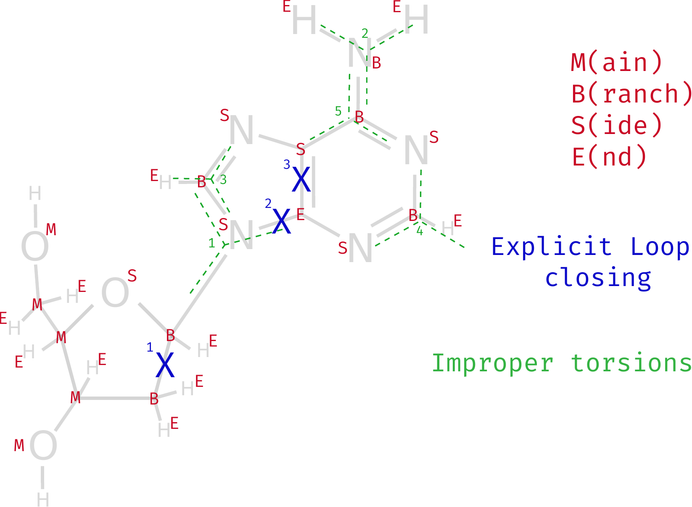

# Start a prep file

## Standard file format

Documentation is found here: [ambermd.org/doc/prep.html](https://ambermd.org/doc/prep.html)

Prep files consist of the following make:

*The parts in between single quotes are condensed bits of information of the keywords on that line.*

```text
 0 0 2                                  'Generally, only a value 2 is required, for ALL ATOM MODELS'
                                        'Leave this line purposefully blank!'
MORPHOLINO-ADENINE                      'This is a remark line; name of the molecule for the database purposes'
MA.res                                  'Residue name in the pdb. Standard here is "molecule.res" '
MA INT 1                                'Residue, Internal Coordinates, binary format output '
CORRECT OMIT DU BEG                     'Correct order of internal coordinates; delete beginning dummy atoms'
0.000                                   'Set to 0.00 and make explicit loop closing bond statements'
   1  DUMM  DU    M    0  -1  -2     0.000    0.00        0.00    .00000
   2  DUMM  DU    M    1   0  -1     1.000    0.00        0.00    .00000
   3  DUMM  DU    M    2   1   0     1.000   90.00        0.00    .00000


IMPROPER                                'Denote which atoms are important when considering improper dihedrals,
                                            always a set of four atoms. Improper torsions are used to keep
                                            the asymmetric centers from racemizing in the united atom model
                                            where all the C-H hydrogens are omitted.
                                            They can also be used to enforce planarity.'


LOOP CLOSING EXPLICIT                   'Depending on the main atoms, which ones are loop closing.
                                            So which ones close the ring system according to the atoms denoted.
                                            Here you only required to add a set of two atoms at a time.'

CHARGE                                  'Override any charges from the dataframe'

DONE                                    'Last line of the molecule's information'
STOP                                    'Only add a stop statement if this is the final molecule in your file
                                            this is needed as the prep file is read in as an infinite loop.'
```

Sidenote for improper dihedrals.
These are of special interest when designing and defining the nucleobase moiety,
as all substituents on it are very likely to be flattened for the simulation.

```text
An IMPROPER torsion is any torsion where a set of four atoms are not bonded consecutively.
Improper torsions are used to keep the asymmetric centers from racemizing in the united atom model
    where all the C-H hydrogens are omitted.
They can also be used to enforce planarity. Especially interesting for nucleobases.

The standard case is:

    where the central atom (K) is the third (3rd) atom in the improper                      J
    and the order of the other three is determined alphabetically                           |
    by atom type and if types are the same by atom number.                                  K
    The improper torsions should be defined in such a way that                             / \
    the proper torsions are not duplicated. The atoms making the following -->            I   L

                                                                                    Improper I-J-K-L
```

## Tree Structure: Topological Types

- **DU** Dummy atoms; PREP requires that three dummy atoms precede the actual atoms of the residue.
  These atoms are simply used to define the orthogonal space axis for the residue.
- **M** Main; Main atoms describe the principal "path" through the residue,
  starting at the connection to the previous residue and ending at the connection to the next residue.
- **B** Branch; An atom that must have a total of three (3) connections.
- **S** Side; An atom that must have a total of two (2) connections to other atoms.
- **E** End; An atom that has only one (1) connection to other atoms, thus is the "dead end" of the tree structure.
- **3, 4, 5, 6** A "3"-type atom has four connections, and the rest follows the series (ascending amount of possible bonds).
  For most organic molecules, unless interesting protonation states occur (that are not defined by other names) or intense dative bonding,
  except for "3", this is not really employed too much.

## AMBER Atom Typing

Extensive documentation on atom typing can be found in
[AMBER atom types with GAFF alternative atom types](miscellaneous.md#amber-atom-types-with-gaff-alternative-atom-types).

## Prep File Structure

| Index | Name of Atom | AmbFFname | Top. Type | CONECT1 | CONECT2 | CONECT3 | Bond | Angle  | Dihedral | Charge  |
| :---: | :----------: | :-------: | :-------: | :-----: | :-----: | :-----: | :--: | :----: | :------: | :-----: |
|   1   |     DUMM     |    DU     |     M     |    0    |   -1    |   -2    | 0.00 |  0.00  |   0.00   | 0.0000  |
|   2   |     DUMM     |    DU     |     M     |    1    |    0    |   -1    | 1.00 |  0.00  |   0.00   | 0.0000  |
|   3   |     DUMM     |    DU     |     M     |    2    |    1    |    0    | 1.00 | 90.00  |   0.00   | 0.0000  |
|   4   |     H6T      |    HO     |     M     |    3    |    2    |    1    | 1.00 | 90.00  |  180.00  | 0.4532  |
|   5   |     O6'      |    HO     |     M     |    4    |    3    |    2    | 1.00 | 110.00 |  180.00  | -0.6862 |
|   6   |     C6'      |    CI     |     M     |    5    |    4    |    3    | 1.40 | 110.00 |  180.00  | 0.0279  |
|   7   |     H6'      |    H1     |     E     |    6    |    4    |    3    | 1.00 | 110.00 |  -60.00  | 0.0773  |
|   …   |      …       |     …     |     …     |    …    |    …    |    …    |  …   |   …    |    …     |    …    |
|  11   |     O5'      |    OS     |     S     |    9    |    6    |    5    | 1.40 | 110.00 |  60.00   | -0.3487 |
|   …   |      …       |     …     |     …     |    …    |    …    |    …    |  …   |   …    |    …     |    …    |

- Add only a single line between the required table and the extra optional statements (`CHARGE`, `LOOP`, `IMPROPER`, `DONE`).
- **NB** The Bond, Angle and Dihedral column is typically what is known as a Z-matrix or a set of Internal Coordinates
  ([Z-matrix wikipedia page](https://en.wikipedia.org/wiki/Z-matrix_(chemistry))).
- When the (`INT`) keyword is used, PREP reads but disregards the connectivities and bond, angle and dihedral columns when supplied with a model structure.
  We use this to our advantage, since we already have a given model instead of trying to generate it through tLEaP (which is what the Z-matrix is for).

## Atom type tree and structure

The following figure shows a depiction of the textfile contents of `PATH/TO/AMBER/amber18/dat/leap/prep/nucleic10.in`.



Here is an example of what a prep file can look like:

```text
    1    0    2

db94.dat
D-ADENOSINE - with 5' - OH end group and 3' - O(minus)

 DA5  INT     1
 CORRECT NOMIT DU   BEG
   0.0
   1   DUMM  DU    M    0  -1  -2    0.00      0.00      0.00       0.0000
   2   DUMM  DU    M    1   0  -1    1.00      0.00      0.00       0.0000
   3   DUMM  DU    M    2   1   0    1.00     90.00      0.00       0.0000
   4   HO5'  HO    M    3   2   1    1.00    120.00    180.00       0.4422
   5   O5'   OH    M    4   3   2    0.96    101.43    -98.89      -0.6318
   6   C5'   CI    M    5   4   3    1.44    119.00    -39.22      -0.0069
   7   H5'   H1    E    6   5   4    1.09    109.50     60.00       0.0754
   8   H5''  H1    E    6   5   4    1.09    109.50    -60.00       0.0754
   9   C4'   CT    M    6   5   4    1.52    110.00    180.00       0.1629
  10   H4'   H1    E    9   6   5    1.09    109.50   -200.00       0.1176
  11   O4'   OS    S    9   6   5    1.46    108.86    -86.31      -0.3691
  12   C1'   CT    B   11   9   6    1.42    110.04    105.60       0.0431
  13   H1'   H2    E   12  11   9    1.09    109.50   -240.00       0.1838
  14   N9    N*    S   12  11   9    1.52    109.59   -127.70      -0.0268
  15   C8    CK    B   14  12  11    1.37    131.20     81.59       0.1607
  16   H8    H5    E   15  14  12    1.08    120.00      0.00       0.1877
  17   N7    NB    S   15  14  12    1.30    113.93    177.00      -0.6175
  18   C5    CB    S   17  15  14    1.39    104.00      0.00       0.0725
  19   C6    CA    B   18  17  15    1.40    132.42    180.00       0.6897
  20   N6    N2    B   19  18  17    1.34    123.50      0.00      -0.9123
  21   H61   H     E   20  19  18    1.01    120.00    180.00       0.4167
  22   H62   H     E   20  19  18    1.01    120.00      0.00       0.4167
  23   N1    NC    S   19  18  17    1.34    117.43    180.00      -0.7624
  24   C2    CQ    B   23  19  18    1.33    118.80      0.00       0.5716
  25   H2    H5    E   24  23  19    1.08    120.00    180.00       0.0598
  26   N3    NC    S   24  23  19    1.32    129.17      0.00      -0.7417
  27   C4    CB    E   26  24  23    1.35    110.80      0.00       0.3800
  28   C3'   CT    M    9   6   5    1.53    115.78   -329.11       0.0713
  29   H3'   H1    E   28   9   6    1.09    109.50     30.00       0.0985
  30   C2'   CT    B   28   9   6    1.53    102.80    -86.30      -0.0854
  31   H2'   HC    E   30  28   9    1.09    109.50    120.00       0.0718
  32   H2''  HC    E   30  28   9    1.09    109.50    240.00       0.0718
  33   O3'   OS    M   28   9   6    1.42    116.52   -203.47      -0.5232

IMPROPER
 C8   C4   N9   C1'
 C6   H61  N6   H62
 N7   N9   C8   H8
 N1   N3   C2   H2
 C5   N1   C6   N6

LOOP CLOSING EXPLICIT
 C1'  C2'
 C4   C5
 C4   N9

DONE
```
