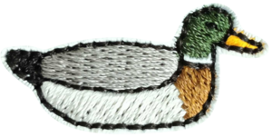

# Introduction

> There are no mistakes, only happy little accidents.
>
> — Bob Ross

**A software for the purpose of building native and synthetic nucleic acid duplexes.**

Ducque (IPA: /dʌk/) stands for:

- **D** Acronyms
- **U** Are
- **C** Rather
- **Q**
- **U**
- **E** Tedious

The name was inspired much in the same way that the ORCA Quantum Mechanics package[^neese2020][^neese2022] was named.
At the time of development, I had a different name for Ducque.
During one of my evaluation moments, one of the members of my advisory committee pointed out that with that name,
I would probably not get enough traction, since Google searches gave millions of results.
Given that fact, I tried coming up with a new name for the model builder.
Weeks later, as I was working, my hat that was resting on my desk in front of me caught my eye.
You see, my hat has a tiny duck embroidered on the front.
With this idea, I "researched" ways to rewrite the word and get as little search engine results as possible,
without degenerating the word itself and keeping it phonetically somewhat correct.
Thusly, Ducque was born (a second time).

## Modules

Ducque has five modules the user can access.

1. The [build](../usage/build.md) module will build the user the duplex structures we want to use for further experiments.
2. The [transmute](../usage/transmute-nucleoside.md) module will be used to convert a specific nucleotide to a suitable input for Ducque to use as a **building block**.
3. The [randomise](../usage/randomise.md) module will generate a randomised sequence that can be readily prompted to the build module to make a structure.
4. The [xyz_pdb](../usage/xyz-to-pdb.md) module exists because many QM packages output `xyz`-formatted files after geometry optimisation.
   For most intents and purposes, the user might need to use `pdb`-formatted files.
   This module facilitates conversion from one format to the other through the CLI.
5. The [GUI](../usage/gui.md) (Graphical User Interface) provides the user with clickable objects and predefined widgets to use Ducque,
   allowing the user to opt out of the CLI functionality.
   This module gives the user access to the build, transmute and randomise modules.

## Package structure

The contents of `path/to/Ducque`:

- `docs/`: contains this manual.
- `json/`: contains the building blocks required by Ducque to build duplex sequences; `json` format.
- `src/`: contains Ducque's **source code**.
- `transmute/`: contains the transmute input files; `tinp` format.
- `xyz/`: contains the xyz_pdb input files.
- `LICENSE` (MIT).
- `README.md` (GitHub).

[^neese2020]: Neese F, Wennmohs F, Becker U, Riplinger C.
    The ORCA quantum chemistry program package.
    *J. Chem. Phys.* 2020, 152, 224108. DOI: [10.1063/5.0004608](https://doi.org/10.1063/5.0004608)

[^neese2022]: Neese F.
    Software update: The ORCA program system—Version 5.0.
    *WIREs Comput. Mol. Sci.* 2022, 12, e1606. DOI: [10.1002/wcms.1606](https://doi.org/10.1002/wcms.1606)
