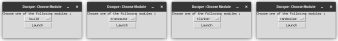
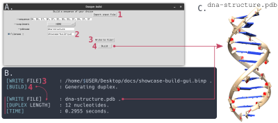
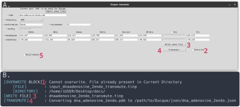
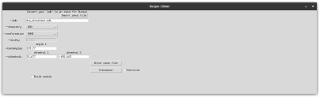
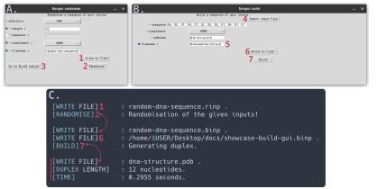

# Graphical User Interface (GUI)

The **GUI** module allows the user to access the other modules from a neat GUI instead of the CLI.
The GUI is called by the following command, and specific modules are more quickly accessed by adding to the query:

```bash
# Ducque calls to GUI modules
Ducque --gui

# Query to open specific modules
Ducque --gui build
Ducque --gui transmute
Ducque --gui tlinker
Ducque --gui randomise
```

The first command gives the user the option to access the modules, this defaults to `build`.



The xyz_pdb module was not made available as a GUI because it was difficult to implement a neat interface.
As such, it is only available as a CLI command, where it performs better.

## Build

We refer to [Build](build.md) for the explanation on the various `--build` arguments.



***A.** The build GUI.
**B.** What gets outputted to `stdout` when using Ducque.
**C.** The produced molecular structure.
**1.** Import a `binp` if desired or if possible. The user can also just write the query by hand.
**2.** Optionally, rename the `binp` file to something else.
**3.** Save the new `binp`, after having filled in the `pdbname` query.
**4.** Build a model structure based on the produced `binp` file.*

In panel A of the figure above, we see the GUI of this module.
The `complement` flag shows an option-list from which we can query the type of chemistry we want.
This list is dependent on the **keys** of the table defined in
[Adding the backbone atoms](../user-implementation/library-tables.md#adding-the-backbone-atoms-by-which-ducque-needs-to-build).

## Transmute Nucleoside

We refer to [Transmute Nucleoside](transmute-nucleoside.md) for the explanation on the different arguments.



***A.** The transmute GUI.
**B.** What gets outputted to `stdout` when using Ducque.
**1.** After having imported a specific `tinp` file and modified some of the data, we can write to the same file.
However, to avoid accidental overwriting of the same file, the user can only write to the same file in the current working directory
if the **Overwrite** button has been checked.
This also prohibits from using the **Transmute!** button, if the `json` already exists in the `path/to/Ducque/json` directory.
**2.** Check the button to allow writing to existing files on the system.
**3.** With the given query, a `tinp` file will be written to the current working directory.
**4.** Convert the `tinp` to a `json` file.
**5.** This functionality is a built-in part of the build module, within the transmute module.
This will come in later into play, but essentially facilitates the iterative approach to tweaking and modifying torsion angles
for the given input by allowing transmuting and building within a few clicks
(see [Defining the correct torsion angle](../user-implementation/torsion-angles.md)).*

In panel A of the figure above, we see the GUI of this module.
The `chemistry` flag shows an option-list from which we can query the type of chemistry we want.
This list is dependent on the **keys** of the table defined in
[Adding the backbone atoms](../user-implementation/library-tables.md#adding-the-backbone-atoms-by-which-ducque-needs-to-build).

## Transmute Linker

We refer to [Transmute Linker](transmute-linker.md) for the explanation on the different arguments.
This procedure is nearly identical to [Transmute Nucleoside](#transmute-nucleoside).



*GUI module to implement new linker moieties.*

## Randomise

We refer to [Randomise](randomise.md) for the explanation on the various `--randomise` arguments.



***A.** The randomise GUI.
**B.** The build GUI.
**C.** What gets outputted to `stdout` when using Ducque.
**1.** After filling in the query, write to a `rinp` file.
**2.** Randomise an output based on the produced `rinp` file. This produces a `binp` file, with which one can readily build.
**3.** Click the button to close the randomisation module and go straight to the build module.
**4.** Import the created `binp` into the module to fill in the queries.
**5.** Optionally, rename the `.binp` file to something else.
**6.** Save the new `binp`, after having filled in the `pdbname` query.
**7.** Build a model structure based on the produced `binp` file (panel C of the figure under [Build](#build)).*

In panel A of the figure above, we see the GUI of this module.
The `chemistry` and the `complement` flag show an option-list from which we can query the type of chemistry we want.
This list is dependent on the **keys** of the table defined in
[Adding the backbone atoms](../user-implementation/library-tables.md#adding-the-backbone-atoms-by-which-ducque-needs-to-build).
