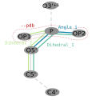

# Transmute Linker (tlinker)

Implementing the linker into the `src` of Ducque can be found at
[Adding the atoms of the linker](../user-implementation/library-tables.md#adding-the-atoms-of-the-linker-to-orient-it-correctly).

*Representation of the linker moiety required to build into Ducque and its accompanying parameters.*

## PDB

`--pdb`: Relative pathing to the `pdb` file of the molecule that the user wants to incorporate into the library.

Looking at the figure above, it is only asked of the user to supply the linker part (demarcated in red).
This makes some linkers extremely versatile in usage.

For example: even though the **MNA nucleotides** are synthesised with a phosphoramidate bond, the **phosphate linker** can still be used to build out the structure.
The phosphate linker only consists of the set `[P, OP1, OP2]`.

## Chemistry

`--chemistry`: The **chemistry** denotes the type of modification the molecule bears.
For example: the commonly used phosphate linker is just annotated as the `PHOSPHATE` moiety.
The chemistry has direct relations to its **key** in
[Adding transmutation specifications](../user-implementation/library-tables.md#adding-transmutation-specifications) and
[Adding the atoms of the linker](../user-implementation/library-tables.md#adding-the-atoms-of-the-linker-to-orient-it-correctly).

## Moiety

`--moiety`: The Ducque software distinguishes two main parts of a molecule, being the **nucleoside** and the **linker**.
Specifically, the building starts with a linkerless nucleoside, onto which the linker part is fitted.
Because many different chemistries can share the same linker, and because it is useful to separate both parts when building and also on a coding-level,
it was decided to allow nucleosides to be incorporated separately from the linker. Also, this diminishes boilerplate inputs.
In [Adding a nucleoside-linker combination](../user-implementation/library-tables.md#adding-a-nucleoside-linker-combination-to-form-a-defined-nucleotide),
the user is mandated to couple the **nucleoside chemistry** and the type of **linker** together.

## Conformation

`--conformation`: This flag allows the user to distinguish the linker inputfiles when a stereocenter comes into play,
or allows just simple insertion of the linker with the `NONE` keyword, like with DNA phosphate.
However, most linkers, like thiophosphates, do contain a stereocenter.
It is up to the user to know which `R`- or `S`-configuration the linker adopts and to annotate this correctly.
For obvious reasons, these are the only valid set of options: [`NONE`, `R`, `S`].

The added benefit to this is that a racemised mixture of linkers can be queried through Ducque, containing both `R` and `S` linkers of the same chemistry.
Another useful thing is that the user can swap the values for `dihedral_1` and `dihedral_2` with each other in order to swap the stereoisomer,
when transmuting the linker as an input for Ducque.
For example, for S-Thiophosphate, the dihedral values are (1: -155.047, 2: 76.677), while for R-Thiophosphate the values read (1: 76.677, 2: -155.047).

## Bond angles

`--bondangles`: The angle defines the orientation of the linker.

For example: the `angle_1` (figure above) contains the set `[O5', P, OP2]`.
Generally, the user may attribute an angle between 109° ≤ X ≤ 120°,
as the main purpose of the linker is to make minimal clashes with the backbone itself and be somewhat correctly oriented.
The rest is handled by the simulation engine and a suitable forcefield.
This is also the reason why there is a single angle value to prompt, as this bond angle can be relatively well generalised for building purposes.

> **To emphasize:** The dihedrals and angles given by the user to the building block are in fact the dihedral/angle Ducque will use
> in order to build out the molecular structure! Giving erroneous dihedral values will result in *warped* molecular structures.

## Dihedrals

`--dihedrals`: The dihedral (torsion angles) defines the orientation of the linker.

A dihedral constitutes an angle between four atoms.
For example: the `dihedral_1` (figure above) contains the set `[C5', O5', P, OP2]`, the `dihedral_2` contains the set `[C5', O5', P, OP1]`.
Generally, the user may attribute relatively the same dihedrals used by the phosphate linker for their own synthetic linkers,
as the main purpose of the linker is to make minimal clashes with the backbone itself and be somewhat correctly oriented.
The rest is handled by the simulation engine and a suitable forcefield.

> **To emphasize:** The dihedrals and angles given by the user to the building block are in fact the dihedral/angle Ducque will use
> in order to build out the molecular structure! Giving erroneous dihedral values will result in *warped* molecular structures.
