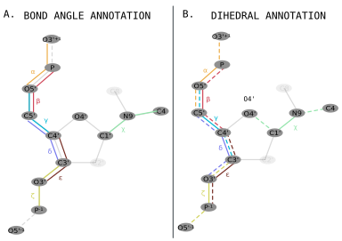

# Transmute Nucleoside

The **transmute** module allows the user to incorporate nucleotides (building blocks) into Ducque's repository to be able to build nucleic acid duplexes with.
The transmute inputfiles are highlighted with the `.tinp` file extension (**t**ransmute-**inp**ut).
The conversion to a suitable inputfile is stored as a `json`-formatted file in the repository itself.
The json files are never to be written by hand and are mandated to be generated by the transmute module!

```bash
Ducque --transmute INPUTFILE.tinp
```

An example is given of the `tinp` file of DNA Adenosine:

```text title="input_dnaadenosine_2endo_transmute.tinp"
--pdb dna_adenosine_2endo.pdb
--chemistry DNA
--conformation 2endo
--moiety nucleoside
--nucleobase A
--dihedrals -39.246, -151.431, 30.929, 156.517, 159.171, -98.922, -99.315
--bondangles 101.407, 118.980, 110.017, 115.788, 111.943, 119.045, 126.013
```

## PDB

`--pdb`: Relative pathing to the `pdb` file of the molecule that the user wants to incorporate into the library.

**Nota bene:** before using the `pdb` file, it has to be presented as an uncapped molecule.
For example, when looking at the [atom naming figure](xyz-to-pdb.md), we see the `HO5'` and `HO3'` atoms capping the backbone.
These atoms need to be removed before using the specific `pdb` file as an input for the transmute module!
When finishing the building, terminal hydrogens are appended to either ends of the strands
and their atomnames are inferred from the atom that bind the capping hydrogens.

## Chemistry

`--chemistry`: The **chemistry** denotes the type of modification the molecule bears.
For example: the standard deoxyribose nucleic acids are represented by adenosine, cytidine, guanosine and thymidine nucleosides,
but are categorised under the `DNA` chemistry.
The chemistry has direct relations to its **key** in
[Adding transmutation specifications](../user-implementation/library-tables.md#adding-transmutation-specifications) and
[Adding the backbone atoms](../user-implementation/library-tables.md#adding-the-backbone-atoms-by-which-ducque-needs-to-build).

## Conformation

`--conformation`: Ducque allows for multiple **conformations** to be built into the **complementary strand** of the generated duplex.
For example: DNA chemistries are commonly determined in both the $^{2'}E$ and $^{3'}E$ configuration.
Ducque allows that both are incorporated into the library
([Adding one or more conformations](../user-implementation/library-tables.md#adding-one-or-more-conformations-of-a-nucleoside-chemistry)).
The specific conformation is later inserted in the name of the `json` file to differentiate multiple conformers of the same chemistry
and to avoid naming clashes in the repository.

## Moiety

`--moiety`: The Ducque software distinguishes two main parts of a molecule, being the **nucleoside** and the **linker**.
Specifically, the building starts with a linkerless nucleoside, onto which the linker part is fitted.
Because many different chemistries can share the same linker, and because it is useful to separate both parts when building and also on a coding-level,
it was decided to allow nucleosides to be incorporated separately from the linker. Also, this diminishes boilerplate inputs.
In [Adding a nucleoside-linker combination](../user-implementation/library-tables.md#adding-a-nucleoside-linker-combination-to-form-a-defined-nucleotide),
the user is mandated to couple the **nucleoside chemistry** and the type of **linker** together.

## Nucleobase

`--nucleobase`: This flag is required to allow more flexibility in defining the **residue** name of the molecule.
An earlier consideration was to infer the type of nucleobase from the residue name itself,
but considering that we want to implement a method to accept any type of modified nucleobase in the future,
the maintainer felt that this option might be more useful on a coding level and would disallow errors to propagate based on assumptions.

This flag represents the type of **nucleobase** that pertains to the **nucleoside** that the user wants to implement into Ducque.
The nucleobase infers the complementary base with which it pairs; e.g. the `G` nucleobase infers basepairs with `C`.

For now, only purine and pyrimidine nucleobases are implementable.
Technically, if the nucleobase modification entails only additional substituents
and the naming of the atoms in the ring system remains identical to that of the natural bases, then it should also be implementable.
This feature has not been tested.

## Bond angles

`--bondangles`: The **bondangles** that define the backbone of the nucleotide.

The way the duplex is built is from bottom to top (e.g. from 3' → 5' for DNA).
The way this is reflected, among other things, is in the way the bondangles are required to be queried from the `json` files.
In a set of a dihedral, meaning four (4) atoms, the latter three (3) are to be supplied as the bondangle of the respective backbone angle.

For example: the **γ-dihedral** contains the set `[C3', C4', C5', O5']`.
This means that the **γ-bondangle** contains the set `[C4', C5', O5']` (see the [figure below](#dihedrals), panel A).
These values tend to be relatively stable across all different types of chemistries, given all atoms in a set are sp³ hybridised.
Therefore, one can use the same angles, pertaining to similar atoms involved in the bondangle, from other types of chemistries and it will build fine.
For most, if not all, intents and purposes, the set of angles tend to remain relatively conserved.
This means that, when implementing a new chemistry, the user should focus on the **dihedrals**.

IUPAC nomenclature states the backbone follows the Greek alphabet: [α, β, γ, δ, ε, ζ].[^iupac1983][^saenger1984]
This also involves the glycosidic dihedral of [χ] (panel A of the [figure below](#dihedrals)).
Since IUPAC follows the ordering of the alphabet,
an additional backbone angle is added in case the type of chemistry requires an additional angle to be queried: [η, (eta)].

Not all chemistries require all stated backbone angles and thus the software permits shorter backbone chains too,
like PeptideNA and ThreoseNA, to be built all the same.

> **To emphasize:** The angles given by the user to the building block are in fact the angles Ducque will use in order to build out the molecular structure!
> Giving erroneous bondangle values will result in *warped* molecular structures.

## Dihedrals

`--dihedrals`: The dihedral (torsion angles) that define the backbone of the nucleotide.

A dihedral constitutes an angle between four atoms. For example: the γ-dihedral contains the set `[C3', C4', C5', O5']`.
To procure these values, we redirect the reader to
[Defining the correct torsion angle for the given nucleoside](../user-implementation/torsion-angles.md) for more information.

IUPAC nomenclature states this follows the Greek alphabet: [α, β, γ, δ, ε, ζ].[^iupac1983][^saenger1984]
This also involves the glycosidic angle of [χ] (panel B of the figure below).
Since IUPAC follows the ordering of the alphabet,
an additional backbone torsion is added in case the type of chemistry requires an additional angle to be queried: [η, (eta)].

Not all chemistries require all stated backbone dihedrals and thus the software permits shorter backbone chains too,
like PeptideNA and ThreoseNA, to be built all the same.

> **To emphasize:** The dihedrals and angles given by the user to the building block are in fact the dihedral/angle Ducque will use
> in order to build out the molecular structure! Giving erroneous dihedral values will result in *warped* molecular structures.



*Representation of the **A.** bond angles and **B.** dihedrals in the backbone of nucleic acid nucleotides.
This represents how one can consider inputting the values for their own type of chemistries.
Notice the bottom to top direction in the annotated bond angles (**A.**).*

[^iupac1983]: IUPAC-IUB Joint Commission on Biochemical Nomenclature (JCBN).
    Abbreviations and Symbols for the Description of Conformations of Polynucleotide Chains.
    *Eur. J. Biochem.* 1983, 131, 9–15. DOI: [10.1111/j.1432-1033.1983.tb07225.x](https://doi.org/10.1111/j.1432-1033.1983.tb07225.x)

[^saenger1984]: Saenger W.
    Structures and Conformational Properties of Bases, Furanose Sugars, and Phosphate Groups.
    In: *Principles of Nucleic Acid Structure*. Springer New York, 1984, 51–104.
    DOI: [10.1007/978-1-4612-5190-3_4](https://doi.org/10.1007/978-1-4612-5190-3_4)
