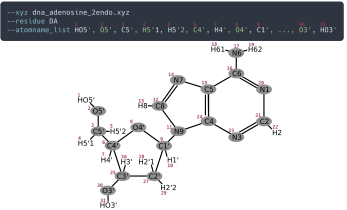

# XYZ → PDB

The **xyz_pdb** module allows the user to convert from an `xyz` to a `pdb` formatted file.
Both are generally readable by all Molecular Viewing Software, but the `pdb` format is the only format accepted by Ducque,
in order to [transmute](transmute-nucleoside.md) the molecule into a suitable building block for model building.

An `xyz` file is a file consisting only of the atomic coordinates and the atomic elements.

```bash
Ducque --xyz_pdb INPUTFILE
```



*Depiction of the way in which atomnames are assigned according to the [AMBER Tree Structure](https://ambermd.org/doc/prep.html).*

## XYZ

`--xyz`: one of the following.

- Relative path to the `xyz` file the user wants to convert.
- A directory that contains `xyz` files, meaning multiple different files of **the same molecule**.
  When performing Conformational Sampling experiments, the user is left with all possible configurations a molecule can adopt.
  To facilitate conversion to the more useful `pdb` format, it suffices to query the name of the directory where those `xyz` files live.
  Again, this has to be a directory of a single type of molecule.

## Residue

`--residue`: The name of the **residue** attributed to the specific chemistry,
as per the [PDB format](https://www.cgl.ucsf.edu/chimera/docs/UsersGuide/tutorials/pdbintro.html).
String names can not exceed three (3) characters.
The residue name has direct relations to its **key** in
[Adding a nucleoside-linker combination](../user-implementation/library-tables.md#adding-a-nucleoside-linker-combination-to-form-a-defined-nucleotide) and
[Adding one or more conformations](../user-implementation/library-tables.md#adding-one-or-more-conformations-of-a-nucleoside-chemistry).

## Atom name list

`--atomname_list`: The **atom name** attributed to the specific atom in the molecule,
as per the [PDB format](https://www.cgl.ucsf.edu/chimera/docs/UsersGuide/tutorials/pdbintro.html).
String names can not exceed four (4) characters per atom name. The figure above follows the AMBER Tree Structure.
