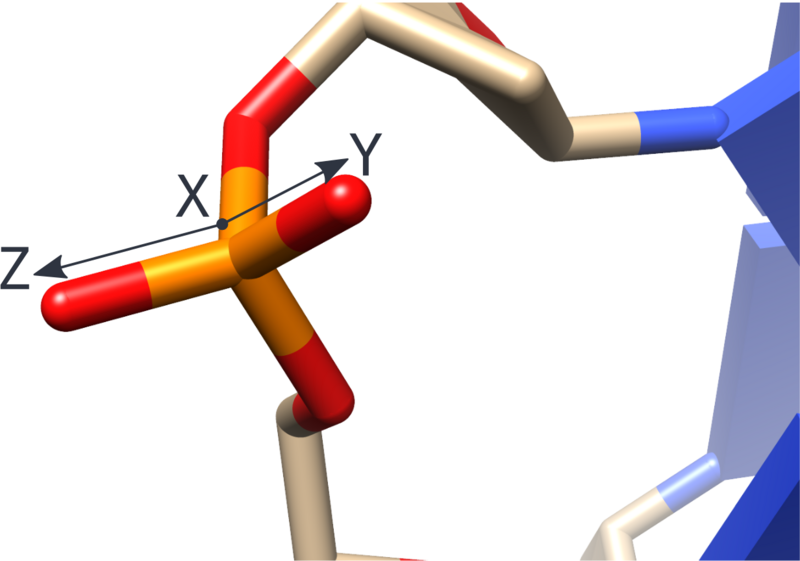

# How to add to Ducque's src files

This section concerns the incorporation of **custom types of chemistries** into **Ducque's repository**.
This is done by modifying one of the **python** files in the **source code** itself.

```bash
# Go to the src files
cd path/to/program/Ducque/src/ducquelib/

# Open file in your preferred text editor
vim library.py
```

The reason why a python script is modified, and not some sort of configuration file, is two-fold:

1. In order to create a configuration file, one needs to depend on various typed formats, like `yml`, `json`, `toml` etc.
   Though many libraries exist to parse these formats, they (especially the first two) tend to be somewhat finicky if implemented by hand.
   To combat this issue, one would have to write a specified format and have it be parsed by such a library.
   Writing a specific format brings many I/O issues that bring more trouble than they are useful.
   When in reality, the only thing we'd need is a dictionary (a.k.a. table, hashmap …) with the given inputs. This brings me to my second point.
2. What better parser can be asked to parse a native **data structure**, the dictionary, than the **python interpreter** itself.
   What the maintainer proposes is that errors in **python source code** are caught immediately.
   This means that, upon running Ducque, all code is checked and looked for **syntax errors**.
   If, and when, these errors are encountered, Ducque will not be called, which is the desired behaviour when such an error has been found.
   Even better, the **Python Error Handling** will return a message stating the exact problem of why the error has been encountered
   and thus one can fix their **syntactic mistakes**. This often involves missing a comma, square brackets or curly braces.

## Adding a nucleoside-linker combination to form a defined nucleotide

This section allows the user to implement the correct combination of **nucleoside** and **linker** to **Ducque's repository**.
The way this is formed is through `{KEY : VALUE}` pairs, more commonly referred to as a dictionary.

Important to note here is that the given conformation will be the conformation with which **Ducque will build the leading strand**,
for the nucleoside-linker pair in `TABLE_NUCLEOTIDES`!

```python
# GO TO +- line 18
# ----------------------------------------------------------------------------
#                   NUCLEOSIDE              ,             LINKER
# ----------------------------------------------------------------------------
DH = path/to/Ducque # DUCQUE_HOME
TABLE_NUCLEOTIDES = {
"DA" : [ DH + "dna_adenosine_2endo.json", DH + "dna_phosphate.json"],
"DG" : [ DH + "dna_guanosine_2endo.json", DH + "dna_phosphate.json"],
#                          ...                             ...
"FOO" : [ DH + "foo_nucleoside.json", DH + "bar_linker.json"],
}
```

- The `KEY` is the **residue name** ([`--residue`](../usage/xyz-to-pdb.md#residue)) that was used in the `pdb` file
  ([`--pdb`](../usage/transmute-nucleoside.md#pdb)), upon transmuting the parameters of the desired nucleoside.
  This `KEY` is a **string** and has to be **ALL CAPS**.
- The `VALUE` is a python **list** that contains two values: the name of the nucleoside and the name of the associated linker, as **string**-typed values.
- The `DH` variable (DUCQUE_HOME) is the place where Ducque lives on the user's machine; this is evaluated at runtime.
  The user needs only to prepend `DH +` to the name of the files pertaining to the nucleotide incorporated.
  To clarify, the inputfiles for Ducque are stored as `json` files in the `path/to/Ducque/json/` directory, upon transmuting the inputs,
  so this removes a lot of boilerplate text in the repository.

## Adding one or more conformations of a nucleoside chemistry

This section is similar to [the previous one](#adding-a-nucleoside-linker-combination-to-form-a-defined-nucleotide),
but builds **the complementary strand**.
This allows the user to implement **multiple conformations of the same chemistry** to be used while building that strand.
Building out the complement involves several fitting procedures.
If more than one conformation exists of a type of chemistry,
Ducque will try its best to fit the best conformation to the leading strand and its adjacent stacking nucleotides.

Again, the `{KEY : VALUE}` pairs are crucial to our repository.
The dictionary below is used to insert multiple conformations into Ducque for a specific residue, to build out the complementary strand.

```python
# GO TO +- line 75
# -----------------------------------------
#       COMPLEMENTARY REPOSITORY
# -----------------------------------------
TABLE_CONFORMATIONS = {
"DA": [ DH + "dna_adenosine_2endo.json", DH + "dna_adenosine_3endo.json"],
"RG": [ DH + "rna_guanosine_3endo.json"],
#                          ...                             ...
"FOO": [ DH + "foo_nucleoside_Xendo.json", DH + "foo_nucleoside_Yexo.json"],
}
```

- The `KEY` is the **residue name** ([`--residue`](../usage/xyz-to-pdb.md#residue)) that was used in the `pdb` file
  ([`--pdb`](../usage/transmute-nucleoside.md#pdb)), upon transmuting the parameters of the desired nucleoside.
  This `KEY` is a **string** and has to be **ALL CAPS**.
- The `VALUE` is a python **list** that contains two values: the name of the respective nucleoside conformations, as **string**-typed values.
- The `DH` variable (DUCQUE_HOME) is the place where Ducque lives on the user's machine; this is evaluated at runtime.
  The user needs only to prepend `DH +` to the name of the files pertaining to the nucleotide incorporated.
  To clarify, the inputfiles for Ducque are stored as `json` files in the `path/to/Ducque/json/` directory, upon transmuting the inputs,
  so this removes a lot of boilerplate text in the repository.

## Adding the backbone atoms by which Ducque needs to build

As stated before ([`--bondangles`](../usage/transmute-nucleoside.md#bond-angles)), the software builds from bottom to top (e.g. for DNA: 3' → 5').
This section defines the backbone by which the Ducque model builder should produce the structure with.
In the example below, the DNA and MNA nucleic acid chemistries are given.
Again, the `{KEY : VALUE}` pairs are crucial to our repository.

The dictionary below is used by Ducque to build along a given backbone.
It is one of the most crucial aspects to Ducque and why it allows any backbone modification to be built with this software.

```python
# GO TO +- line 130
# -----------------------------------------
#        BACKBONE REPOSITORY
# -----------------------------------------
# Add atoms of the backbone in ASCENDING ORDER OF APPEARANCE!
TABLE_BACKBONE = {
"DNA" : ["O3'", "C3'", "C4'", "C5'", "O5'"],
"MNA" : ["N3'", "C4'", "C5'", "C6'", "O6'"],
"PHOSPHATE" : ["P"],
"THIOPHOSPHATE" : ["P"],
#                          ...
"FOO" : ["Z", "Y", "X", "W", "V"],
}
```

- The `KEY` is the **chemistry** that was used in the `tinp` ([`--chemistry`](../usage/transmute-nucleoside.md#chemistry)),
  upon transmuting the parameters of the desired nucleoside. This `KEY` is a **string** and has to be **ALL CAPS**.
- The `VALUE` is a python **list** that contains all atoms of the backbone, in **ascending order**
  (callback to [`--bondangles`](../usage/transmute-nucleoside.md#bond-angles)).
  The list is a set of comma-separated **string**-typed values, that pertain to the **atomnames**
  ([`--atomname_list`](../usage/xyz-to-pdb.md#atom-name-list)) in the prompted `pdb` file ([`--pdb`](../usage/transmute-nucleoside.md#pdb)).

The example above refers to the storage of the information on the **DNA chemistry** (3' → 5') and the **MNA (Morpholino) chemistry** (3' → 6').
This is why it is important to be **consistent** with the nomenclature of the atoms in the molecule and the order in which they appear in the list.
This functionality is what gives Ducque its power, by being able to build with any type of **backbone**!

Ducque will query its repository, based on the **user's input values**.
If these do not align with each other, then Ducque will not be able to build the desired structure, so be precise with your inputs.

## Adding transmutation specifications

This section only exists to add specifications to the `json` file that gets produced.
The idea is that some additional information can go a long way, especially when considering future expansions of Ducque.
This data is not necessary to build structures with, but is required to correctly transmute to a `json` file.
This concerns the full **nucleotide** chemistry. Linker partners are annotated in
[Adding a nucleoside-linker pair explicitly](#adding-a-nucleoside-linker-pair-explicitly).

*Important to note*: if the user specifies a type of backbone modification with a specified R/S-stereoisomer for the linker moiety,
then this has to be uniquely annotated in this section! See the example of the thiophosphate here below,
which couples a key-value pair of the chemistry and its full name.

```python
# GO TO +- line 150
# -----------------------------------------
#       CHEMISTRY REPOSITORY
# -----------------------------------------
TABLE_CHEMISTRY = {
"DNA" : "Deoxyribonucleic acid",
"RNA" : "Ribonucleic acid",
"MNA" : "Morpholino Nucleic Acid",
"S-1DNA" : "R-Thio Deoxyribonucleic acid",
"S-2DNA" : "S-Thio Deoxyribonucleic acid",
#                          ...
"FOO" : "Foobar Nucleic Acid",
}
```

## Adding the atoms of the linker to orient it correctly

Below, we assign the atoms by which Ducque needs to position the linker moiety with consideration to its position for the adjacent nucleic acids.
The dictionary is used by Ducque to position the linker correctly to the nucleoside it is being appended to.
The phosphate linker is used as an example.

```python
# GO TO +- line 140
# -----------------------------------------
#       LINKER BACKBONE  REPOSITORY
# -----------------------------------------
TABLE_LINKER_BACKBONE = {
"PHOSPHATE" : ["P", "OP1", "OP2"],
"THIOPHOSPHATE" : ["P", "SP1", "OP2"],
#                          ...
"BAR" : ["X", "Y", "Z"],
}
```



The reason the user needs only to assign three atoms, is because the linker moiety can be abstracted to a plane (formed by three points).
This means the linker only requires three assigned atoms to be positioned.
The atoms prompted are of course correlated with the angle ([`--bondangles`](../usage/transmute-linker.md#bond-angles))
and dihedrals ([`--dihedrals`](../usage/transmute-linker.md#dihedrals)) used to transmute the linker into a suitable `json` inputfile
([Transmute Linker](../usage/transmute-linker.md)).

## Adding a nucleoside-linker pair explicitly

This final TABLE is the last step needed when implementing a new chemistry.
The names correlate with the **chemistry** type annotated by the user
([`--chemistry`](../usage/transmute-nucleoside.md#chemistry) for nucleosides, [`--chemistry`](../usage/transmute-linker.md#chemistry) for linkers).
Couple a key-value pair of the chemistry of the nucleoside-linker pair.

```python
# GO TO +- line 168
# -----------------------------------------
#           LINKER REPOSITORY
# -----------------------------------------
TABLE_LINKER = {
"DNA" : "PHOSPHATE",
"MNA" : "PHOSPHATE",
"S-1DNA" : "THIOPHOSPHATE",
"S-2DNA" : "THIOPHOSPHATE",
#               ...
"FOO" : "BAR",
}
```
